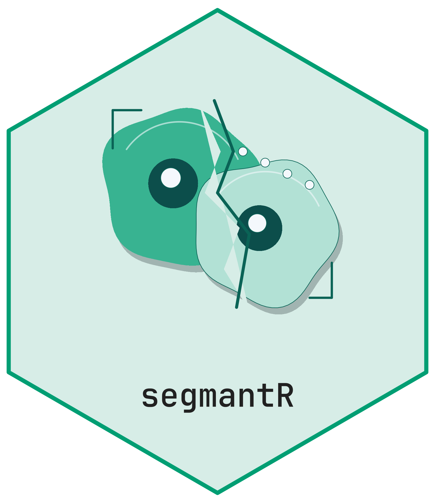

# segmantR <picture class="cttir-readme-logo"><source class="cttir-logo-dark-source" media="(prefers-color-scheme: dark)" srcset="man/figures/logo-with-name-dark.png" /></picture>

[](https://doi.org/10.5281/zenodo.21889962)

<!-- badges: start -->
[](https://github.com/CTTIR/segmantR/actions/workflows/R-CMD-check.yaml)
[](https://cttir.github.io/segmantR/)
[](https://app.codecov.io/gh/CTTIR/segmantR?branch=main)
[](https://opensource.org/licenses/MIT)
[](https://lifecycle.r-lib.org/articles/stages.html#experimental)
<!-- badges: end -->

segmantR segments microscopy images, records reproducible segmentation protocols,
and exchanges masks and measurements with downstream tools. The core threshold
and watershed workflows use R; optional external engines require their own
runtimes and model validation.

## Installation

```r
install.packages("remotes")
remotes::install_github("CTTIR/segmantR", build_vignettes = TRUE)
```

See the declared R and package requirements in [DESCRIPTION](https://github.com/CTTIR/segmantR/blob/main/DESCRIPTION).
Installing the R package does not install Python engines or download models.

## Reproducible protocols and exchange

Besides the direct segmentation functions (`sg_segment_threshold()`,
`sg_segment_watershed()`, `sg_segment_propagate()` and the optional
Cellpose, StarDist and Mesmer wrappers), segmantR provides:

* **Versioned declarative protocols** (`segmantR-protocol-v1`):
  `threshold.otsu.v1`, `threshold.adaptive.v1`, `threshold.triangle.v1`,
  `watershed.distance.v1`, `watershed.h_minima.v1`, `propagate.voronoi.v1`,
  `postprocess.label-cleanup.v1` and the optional `stardist.2d.v1`,
  `cellpose.2d.v1`, `mesmer.2d.v1`. Parameters are whitelisted and every run
  records the exact delegate call.
* **A neutral interchange format** (`segmantR-interchange-v1`): JSON
  manifests, exact integer label TIFF, pixel-edge GeoJSON with stable object
  ids, measurement tables with explicit special values, and SHA-256
  inventories. Imports are staged; reviewed masks are protected.
* **Training datasets and model bundles** with grouped, leakage-free splits,
  model cards, runtime descriptions and checksums.
* **QuPath programs**: readable Groovy templates driven by `run.json` for the
  Script Editor and `QuPath script`, and a StarDist parameter adapter.

```r
library(segmantR)
img <- sg_example_image("fluorescence_nuclei")
run <- sg_protocol_run(img, "threshold.otsu.v1", min_area = 5L, output = "run")
bundle <- sg_export_interchange(run, tempfile("bundle"), image = img)
back <- sg_import_interchange(bundle$path, expected_digest = bundle$bundle_digest)
sg_mask_status(back$mask)$status  # "staged"
```

The core runs without Python, QuPath or EBImage; optional backends are
checked when used. Current capability status:

| Contract | Status |
|---|---|
| Neutral files and inventories (I0) | supported |
| Protocols and run envelopes (I1) | supported |
| Model bundles, training datasets | supported |
| QuPath programs, StarDist in QuPath | planned (headless runs verified with QuPath 0.7.0 and StarDist extension 0.6.0; no partner consumer yet) |
| Local control service | planned |

See `vignette("protocols-and-interop", package = "segmantR")` and
`system.file("interop", "INTEROP.md", package = "segmantR")`.

## Citation

If you use this software, please cite it as:

> Heller, R. (2026). *segmantR: Cell segmentation of histology slides with human-in-the-loop training* (Version 0.1.0) [Computer software]. Zenodo. https://doi.org/10.5281/zenodo.21889962

DOI: [10.5281/zenodo.21889962](https://doi.org/10.5281/zenodo.21889962)

## Documentation and support

Start with the [protocols and interoperability vignette](https://github.com/CTTIR/segmantR/blob/main/vignettes/protocols-and-interop.Rmd)
or `vignette("protocols-and-interop", package = "segmantR")`.
Use `help(package = "segmantR")` for the API and
<https://github.com/CTTIR/segmantR/issues> for reproducible bug reports.
The package is MIT licensed; see [LICENSE](https://github.com/CTTIR/segmantR/blob/main/LICENSE).

## Use of LLM tools

Where applicable, LLM tools were used for narrowly defined, non-authorial tasks:
copyediting, prose refinement, Markdown/LaTeX formatting, boilerplate scaffolding
(such as CI configurations and build scripts), and code refactoring. Tools included
[Chat AI](https://kisski.gwdg.de/leistungen/2-02-llm-service/), the KISSKI
(GWDG) service, and self-hosted **Mistral Small (24B, Apache-2.0)** served through
a local **vLLM architecture** on an Ubuntu Linux workstation with Intel
processors and NVIDIA GPUs. The self-hosted model ran locally, with no data sent
to third parties.

All scientific claims, methodological choices, analyses, interpretations and
conclusions remain the authors' own. Where applicable, LLM-generated material
must be reviewed and revised before inclusion, and references must be verified
against their DOI, arXiv ID or ISBN.

Local software setup: vLLM with Python/PyTorch, plus R and RStudio.

## Package responsibility

segmantR owns microscopy cell/nucleus segmentation, manual annotation and
correction, model training, review and QuPath exchange. `hyperannotatR`
(formerly annotatR) owns HSI annotation and evolves independently.

The offline cell drawing engine was adapted from annotatR under its MIT license
(copyright 2026 Raban Heller). Its JavaScript and CSS are maintained here as
`sgcanvas`; no annotatR or hyperannotatR runtime dependency is needed.
`sg_canvas(image, mask)` displays cell boundaries and `sg_canvas_correct()`
converts local pixel polygons into staged mask corrections. The app exposes
rectangle, polygon, freehand, circle, edit and erase tools when htmlwidgets and
magick are installed. Existing image origin/plane metadata is retained.

## Histology ROI annotations

The `sg_roi_*` APIs represent vector annotations independently of integer
instance masks and without an HSI annotation package dependency:

```r
frame <- sg_roi_frame(c(100, 80), pixel_size = c(0.5, 0.8), pixel_unit = "um")
roi <- sg_roi_rect(10, 10, 30, 25, label = "tissue")
layer <- sg_roi_layer_add(sg_roi_layer("review"), roi)
project <- sg_roi_project(frame, layer)
mask <- sg_roi_mask(project, type = "labelled")
sg_roi_mask_stats(mask, pixel_size = frame$pixel_size)
# sg_roi_write_qupath(project, "review.geojson")
# imported <- sg_roi_read_qupath("review.geojson")
```

Frames declare image dimensions, calibration and optional pyramid levels; they
load no pixel data. Geometry, layer editing and masks preserve image coordinates
(top-left origin, x right, y down). Existing `sg_mask`/`sg_export_qupath` APIs
remain available for instance-mask workflows. The ROI transfer does not include
the HSI application or control service. See `system.file("roi-transfer",
"README.md", package = "segmantR")` for provenance and limitations.

## Branding

Editable R sources and regeneration instructions are in
[tools/branding](https://github.com/CTTIR/segmantR/tree/main/tools/branding).
