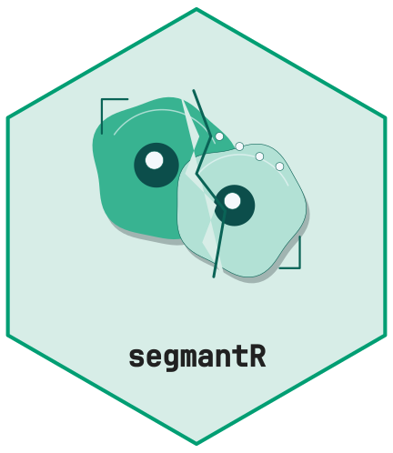
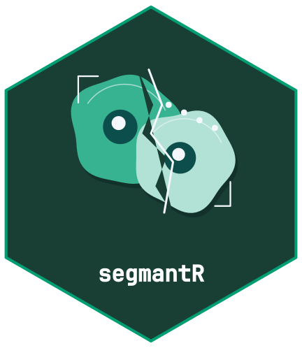

<!-- cttir-vignette-logo: start -->
<style>
.cttir-vignette-logo { float: right; width: 120px; max-width: 30%; margin: 0 0 1rem 1.5rem; }
.cttir-vignette-logo img { width: 100%; height: auto; border: 0; background: transparent; box-shadow: none; }
.cttir-vignette-logo .cttir-vignette-logo-light { display: block; }
.cttir-vignette-logo .cttir-vignette-logo-dark { display: none; }
@media (prefers-color-scheme: dark) {
  .cttir-vignette-logo .cttir-vignette-logo-light { display: none; }
  .cttir-vignette-logo .cttir-vignette-logo-dark { display: block; }
}
[data-bs-theme="light"] .cttir-vignette-logo .cttir-vignette-logo-light { display: block; }
[data-bs-theme="light"] .cttir-vignette-logo .cttir-vignette-logo-dark { display: none; }
[data-bs-theme="dark"] .cttir-vignette-logo .cttir-vignette-logo-light { display: none; }
[data-bs-theme="dark"] .cttir-vignette-logo .cttir-vignette-logo-dark { display: block; }
</style>
<div class="cttir-vignette-logo">
  
  
</div>
<!-- cttir-vignette-logo: end -->

```{r setup, include = FALSE}
knitr::opts_chunk$set(
  collapse = TRUE, comment = "#>",
  fig.width = 6, fig.height = 4.2, dpi = 96, out.width = "80%",
  fig.align = "center"
)
```

```{r}
library(segmantR)
```

This vignette segments a small synthetic fluorescence image, measures the
cells, compares the result with a reference mask and draws the standard
figures. Everything here runs in R alone: no Python, QuPath or Bioconductor
package is needed. The deep learning backends, protocols and exchange
formats are covered in `vignette("protocols-and-interop")`.

## Images and masks

An `sg_image` holds pixels as a `[row, column, channel]` array with channel
names; an `sg_mask` holds an integer label matrix in which 0 is background
and every positive value is one cell. `sg_read_image()` reads image files;
here the built-in synthetic example is used.

```{r}
img <- sg_example_image("fluorescence_nuclei")
img
reference <- sg_example_mask("fluorescence_nuclei")
reference
```

`sg_plot_overlay()` draws one channel with the cell outlines of a mask:

```{r overlay, fig.alt = "Greyscale synthetic fluorescence image of 15 bright nuclei on a dark background, each outlined in magenta along its pixel edges."}
sg_plot_overlay(img, reference)
```

## Segment

Otsu thresholding followed by connected-component labelling is the simplest
method. `min_area` and `max_area` are in pixels.

```{r}
otsu <- sg_segment_threshold(img, method = "otsu", min_area = 5)
otsu
```

Touching nuclei merge under a global threshold. A watershed seeded at the
intensity peaks (`seed_method = "h_minima"`, with `h` as the minimum peak
height) separates some of them:

```{r}
ws <- sg_segment_watershed(img, seed_method = "h_minima", h = 0.1,
                           expand_pixels = 0)
ws
```

```{r comparison, fig.width = 7, fig.height = 3.6, out.width = "100%", fig.alt = "Two label masks side by side on a dark background: the Otsu threshold result on the left and the watershed result on the right, cells coloured by label."}
sg_plot_comparison(otsu, ws, labels = c("Otsu threshold", "Watershed"))
```

## Measure

`sg_extract_features()` returns one row per cell. Intensity columns are
named after the channel, here `DAPI`.

```{r}
feat <- sg_extract_features(img, otsu,
                            features = c("intensity", "morphology"))
feat[, c("cell_id", "DAPI_mean", "area", "circularity")]
```

```{r features, fig.alt = "Scatter plot of mean DAPI intensity against cell area in pixels for the segmented cells, points coloured by circularity."}
sg_plot_features(feat, x = "area", y = "DAPI_mean", color = "circularity")
```

Any measured feature can be mapped back onto the mask:

```{r mask-area, fig.alt = "Label mask in which every segmented cell is filled with a colour for its area, from dark purple for small cells to yellow for large cells."}
sg_plot_mask(otsu, color_by = "area", features = feat)
```

## Evaluate

`sg_evaluate_segmentation()` compares a predicted mask with a reference:
pixel overlap (Dice, Jaccard), the aggregated Jaccard index, panoptic
quality, and detection scores at IoU thresholds of 0.5 and 0.75.

```{r}
metrics <- sg_evaluate_segmentation(otsu, reference)
metrics
```

```{r metrics, fig.height = 3.4, fig.alt = "Horizontal bar chart of seven segmentation metrics between 0 and 1 for the Otsu result, sorted by value."}
sg_plot_metrics(metrics)
```

The pixel overlap is high, but the instance scores show that several
reference nuclei were merged. The watershed result can be scored in the
same way:

```{r}
sg_evaluate_segmentation(ws, reference,
                         metrics = c("aji", "f1_detection"))
```

## Clean up and export

`sg_filter_cells()` removes implausible objects, and `sg_export_mask()`
writes a mask as a label image (TIFF, PNG), as polygons (GeoJSON, QuPath)
or as a table (CSV).

```{r}
kept <- sg_filter_cells(otsu, min_area = 20, max_area = 400,
                        min_circularity = 0.2)
kept
```

## Where next

* `sg_run_app()` opens the Shiny application for interactive correction.
* `sg_segment_cellpose()`, `sg_segment_stardist()` and `sg_segment_mesmer()`
  use a Python environment chosen with `sg_setup_python()`; see
  "Selecting Python" in `?sg_setup_python`.
* `vignette("protocols-and-interop")` covers versioned protocols, the
  neutral interchange format, model bundles and QuPath.
